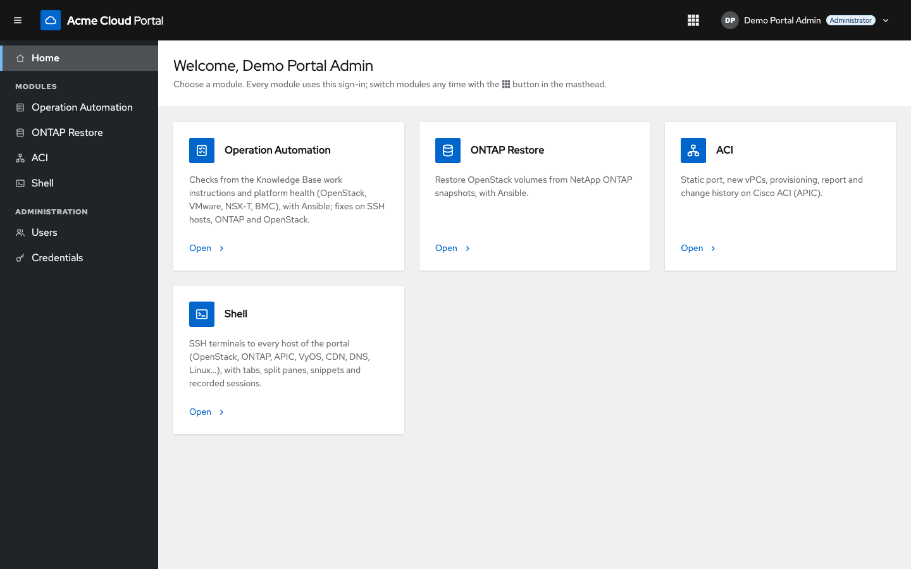
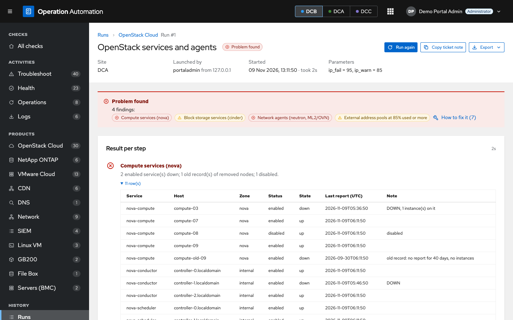
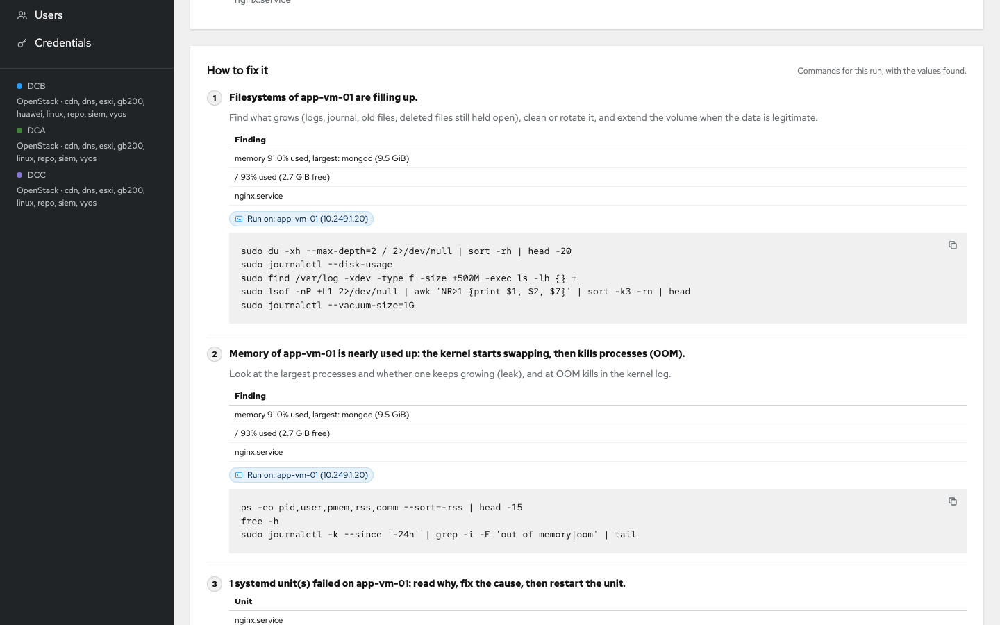
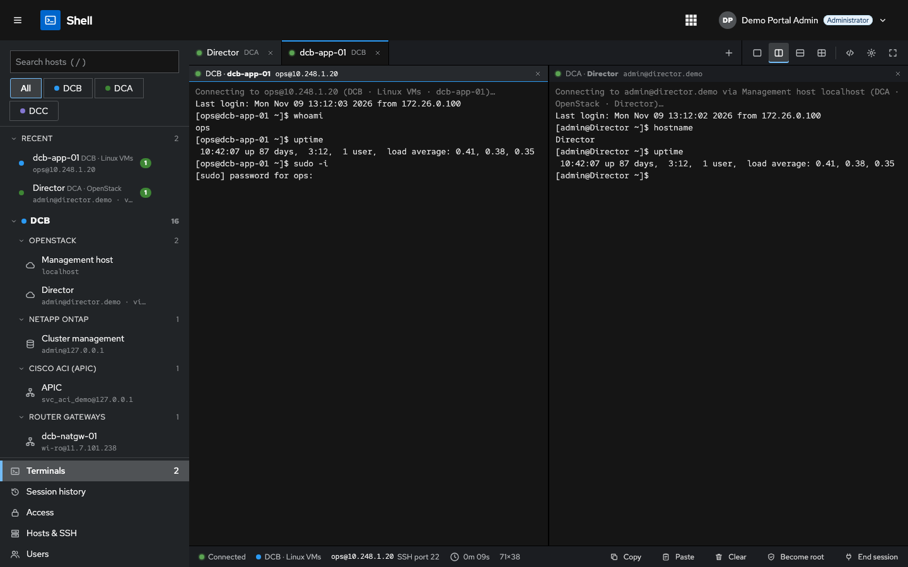
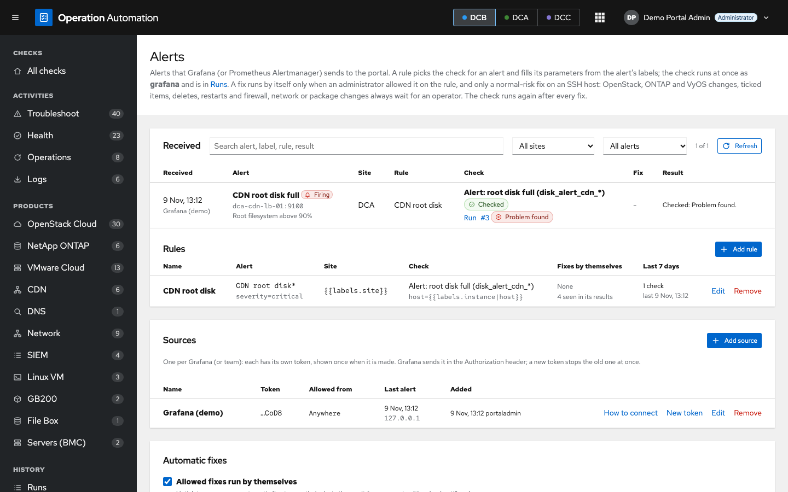
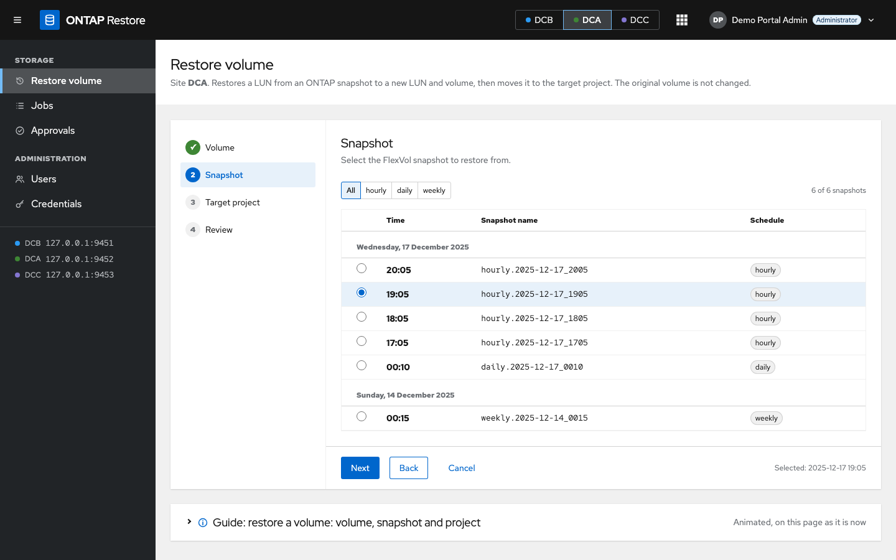
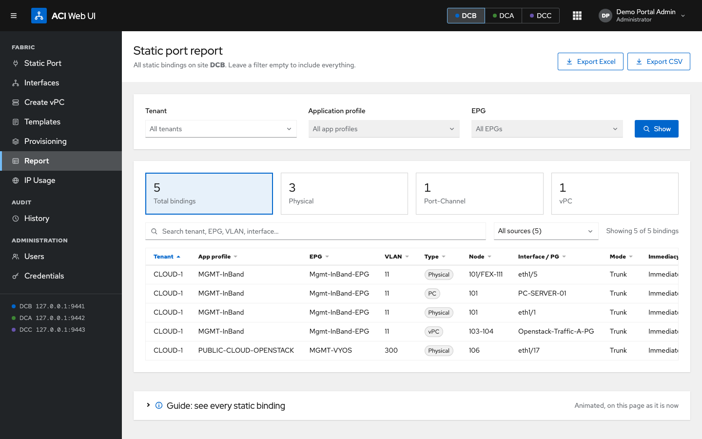

# Ops Portal

A web portal for cloud operations teams. One sign-in gives access to four modules behind a small **Flask**
application: the automation runs with **Ansible**, and the Shell module opens SSH terminals in the browser. The look
follows PatternFly v5 (the AWX / OpenShift console style).

| Module | URL | What it does |
|---|---|---|
| **Operation Automation** | `/wi/` | Runs the checks of the operations work instructions (WI): reads OpenStack (deployed with TripleO / director), NetApp ONTAP, VMware vCenter / NSX-T / vCloud Director, server BMCs (Redfish) and hosts over SSH, rates every step, shows the fix with the real values and, when allowed, runs it |
| **ONTAP Restore** | `/ontap/` | Restores OpenStack (Cinder) volumes from NetApp ONTAP snapshots, with an approval flow for deleting the original volume |
| **ACI** | `/aci/` | Cisco ACI: static port bindings, product templates, provisioning, reports, IP usage and history |
| **Shell** | `/shell/` | SSH terminals in the browser to the hosts the portal knows (like Termius / MobaXterm), with access per host, recorded sessions and live watch / join |

> **About this repository.** It is a sanitized copy of an internal project. Company, product, customer and site
> names, host names, domains, user names and every IP address were replaced with neutral examples (for example
> sites `DCA`, `DCB`, `DCC`, domains `*.example.internal`, addresses in made-up ranges). No credentials, keys or
> runtime data are included. How the copy is produced and updated: [docs/GITHUB.md](docs/GITHUB.md).

## Why a portal

Most of what a cloud operations team looks after has no public address. Hypervisors, controllers, storage and network
controllers, server BMCs, gateways and many VMs answer only on management or private networks, often only from a jump
host. Ops Portal runs on a server inside those networks (the jump host itself, for example), and the team reaches it
over HTTPS:

- Checks, fixes and SSH sessions start from the portal server, so a laptop needs a route to the portal only, not to
  every management network, and no SSH keys or service-account passwords of its own.
- Service-account credentials stay encrypted on the portal server; the browser never receives them.
- Access rules, approvals and one activity log cover everything done on those systems, from every site.
- Each site's management addresses are configured once (`sites.yml`, Hosts & SSH), and every check, fix and terminal
  uses them.

## Screenshots

Taken from the demo mode (`portal/test_mode.sh`): the sites, hosts, addresses and data are made up.

| | |
|---|---|
| **Home**: one sign-in, every module | **Operation Automation**: a check rates every step |
|  |  |
| **How to fix it**: the commands with the real values, run from the portal when allowed | **Shell**: SSH terminals in the browser, split panes |
|  |  |
| **Alerts**: Grafana alerts start the matching checks | **ONTAP Restore**: a volume back from a snapshot, step by step |
|  |  |
| **ACI**: static port bindings per site, with export | |
|  | |

## Contents

- [Why a portal](#why-a-portal)
- [Screenshots](#screenshots)
- [Features](#features)
- [How it works](#how-it-works)
- [Repository layout](#repository-layout)
- [Run it on a laptop (demo mode)](#run-it-on-a-laptop-demo-mode)
- [Tests](#tests)
- [Configuration](#configuration)
- [Deployment](#deployment)
- [Security model](#security-model)
- [Further reading](#further-reading)
- [License](#license)

## Features

**Portal (shared by every module)**
- Sign-in with Active Directory (LDAPS or a Duo Authentication Proxy), Duo Universal Prompt, Duo SSO, or local
  accounts. Users have a role (administrator / operator) and a list of modules they may use.
- Service accounts (APIC, ONTAP, read-only vCenter / NSX-T / vCloud Director accounts) stored encrypted; each is
  tested when it is saved, and a password only goes to the address it was entered for.
- An activity log of every sign-in, change, restore, ACI change and check, with filters and CSV export.
- An application launcher in the masthead to switch modules without signing in again.

**Operation Automation (`portal/modules/wi`)**
- A catalog of work instructions (`catalog.yml`): each entry is a check, planned, manual, or handled by another module.
- Checks are read-only: fixed commands, GET-only REST calls, validated parameters (no free text reaches a shell).
- Every result shows the steps (OK / warning / problem / not checked), the evidence, **how to fix it** with the real
  values of the run, and **where to look**: the console screens (terminal, Horizon, vSphere Client, NSX Manager, ONTAP
  System Manager) drawn with the values found.
- Fixes run from the portal for permitted users: the exact commands are shown first, high-risk fixes need the host
  name typed, the check runs again afterwards. Operations on ticked items (live migration of instances, volume
  migrations, image clean-up) run one item after the other, with progress that survives closing the page.
- Log collection: raw output of every run, log bundles from overcloud nodes, `sos report`, BMC / ONTAP EMS / vCenter
  event exports, kept for 7 days.
- A VyOS router upgrade that follows the work instruction step by step: configuration backup to the jump host, hw-id
  pinning, image copy and checksum, `add system image`, CVE mitigation, reboot with boot-ID detection, growing the disk
  partition when the image store is too small, and a post-check against a baseline (interfaces, addresses, routes,
  NAT, pings), with a roll back.
- Compute drains (live / cold migration) skip an instance that cannot be moved and go on with the next one; the run
  stops when the OpenStack control plane fails or several instances in a row need a person.
- A controller reboot readiness check: Pacemaker quorum and resources, Galera, clustercheck, endpoint security agents
  that can kill cluster helpers, and the kernel a reboot starts, with a safe reboot order per controller.
- **Alerts**: Grafana or Prometheus Alertmanager sends its alerts to a webhook. Matching rules run their checks at
  once and, only where an administrator allowed it, low-risk fixes (never restarts, deletions, network or package
  changes), with cooldowns and a switch that stops every automatic fix. See
  [portal/docs/GRAFANA-ALERTS.md](portal/docs/GRAFANA-ALERTS.md).

**ONTAP Restore (`portal/modules/ontap`)**
- Plans and runs restores of OpenStack volumes from ONTAP snapshots (FlexClone, LUN mapping, Cinder manage), with a
  history, groups, and an approval flow for deleting the original volume (and its instance when it is the boot disk).

**ACI (`portal/modules/aci`)**
- Static port bindings on EPGs from product templates, bulk input, APIC search, a report per site, IP usage per EPG
  with free address suggestions, and an audit history with before / after.

**Shell (`portal/modules/shell`)**
- Terminals in the browser (xterm.js): a host tree per site and product (OpenStack management host and director,
  ONTAP, APIC, the SSH hosts of Operation Automation). ESXi hosts are not listed.
- The portal server runs `ssh` with the stored account; the browser only sends a host id, the keys typed and the
  terminal size, and never sees a password or key.
- Tabs, up to four panes, favorites and recent hosts, snippets, copy on select, and a paste that never presses Enter
  for you. **Become root** types `sudo -i` and the portal answers the account's own sudo prompt.
- Operators open only the hosts an administrator gave them (a site, a product, or single hosts), permanently or
  until a time with a ticket; taking access away ends the open sessions.
- Every session is recorded (activity log and session history). Administrators can watch a live session, join it, or
  end it, and the user sees who is watching.
- Optional Duo SSO step-up before opening a terminal, joining a session or becoming root (off by default). Idle,
  detached and maximum-length timeouts, and limits per user.

## How it works

```
browser ──HTTPS──> nginx ──> gunicorn / Flask (portal/app.py)
                                 │  sign-in, users, credentials, activity (portal_auth.py, SQLite)
                                 │  one Flask blueprint per module (portal/modules/<id>/)
                                 └─> jobs.py ── ansible-playbook ──> SSH / REST to the systems checked or changed
                                                (secrets only in the process environment)
```

- A module is a Python package that registers a Flask blueprint (contract: [portal/MODULES.md](portal/MODULES.md)).
- Long work (checks, fixes, restores, ACI changes) runs as an Ansible job; the page follows its log and result.
- Operation Automation checks are Python classes (`portal/modules/wi/wi_analysis/`): each says what to read per
  phase and how to rate what was read. The playbook `portal/modules/wi/playbooks/run_check.yml` is the same for
  every check.

## Repository layout

| Path | |
|---|---|
| `portal/app.py`, `portal/core.py` | Flask app, module registry, portal routes |
| `portal/portal_auth.py` | sign-in, users, module access, encrypted service accounts |
| `portal/settings.py`, `portal/sites.py`, `portal/jobs.py` | paths (`PORTAL_*` variables), the sites file, the Ansible job runner |
| `portal/modules/wi/` | Operation Automation: catalog, checks (`wi_analysis/`), playbooks, UI |
| `portal/modules/ontap/` | ONTAP Restore: API client, playbooks, UI |
| `portal/modules/aci/` | ACI: APIC client, templates, reports, IP usage, UI |
| `portal/modules/shell/` | Shell: SSH targets, sessions and recordings, access rules, terminal UI (xterm.js vendored, MIT) |
| `portal/templates/`, `portal/static/` | portal pages, PatternFly-style CSS, fonts, application launcher |
| `portal/deploy/` | systemd units, nginx configuration, install / backup scripts |
| `portal/tests/` | unit and flow tests with mocks and fakes (no real system is touched) |
| `portal/*.example.yml` | example configuration (sites, sign-in) |
| `portal/docs/` | coverage of the work instructions, access needed by the checks, Grafana alerts, demo data |
| `docs/` | architecture decisions (ADR) and the UI specification |
| `tools/` | build and deploy helpers, test scripts for an OpenStack lab, an ACI access-policy dump tool |
| `bastion/portal-proxy/` | a small Windows proxy used to reach the portal from a jump host |

## Run it on a laptop (demo mode)

Requirements: Python 3.11 or later (developed with 3.14), `ansible-core`.

```bash
cd portal
python3 -m venv .venv
.venv/bin/pip install -r requirements.txt
./test_mode.sh
```

It opens <http://localhost:8083> with mock APICs, mock ONTAP clusters, a mock vCenter / NSX-T / vCloud Director, a fake
OpenStack director, fake SSH hosts (also behind the Shell terminals) and a fake Active Directory. Nothing real is
touched. The script prints the demo accounts and what to try. `DEMO_REAL_SHELL=1 ./test_mode.sh` opens a real bash on
your own machine in the Shell terminals instead of the fake hosts (nothing connects anywhere).

## Tests

Run each suite in its own process (each one sets up its own sites and data folders when it is imported):

```bash
cd portal
for s in tests/test_*.py; do s=${s%.py}; .venv/bin/python -m unittest "${s//\//.}" || break; done
```

`tests.test_wi` and `tests.test_ontap` take about 15 and 10 minutes: Ansible really runs.

The tests use the standard library `unittest` and the fakes in `portal/tests/` (fake hosts, fake cloud, mock Redfish,
mock ONTAP, mock APIC, fake LDAP / Duo / SSO).

## Configuration

| File | |
|---|---|
| `sites.yml` (from `portal/sites.example.yml`) | per site: APIC, ONTAP, OpenStack management host and director, vCenter, NSX-T, vCloud Director, SSH hosts |
| `auth.yml` (from `portal/auth.example.yml`) | sign-in: AD / LDAPS, Duo, SSO, local accounts, trusted proxies |
| `ops-portal.env` (`portal/deploy/`) | service settings: port, TLS, host name, data folders, timeouts |
| `credentials.key` | the key that encrypts service accounts (created at install, never in the repository) |

Service-account passwords are entered in the portal (Administration → Credentials), not in files.

## Deployment

`portal/deploy/install.sh` installs or updates the portal on a Linux server: a service user, the application in
`/opt/ops-portal`, a virtualenv from local wheels (offline install), the systemd service (gunicorn on
127.0.0.1) and nginx in front (TLS). Configuration lives in `/etc/ops-portal`, data in `/var/lib/ops-portal`
(SQLite) with a daily backup timer. `tools/build_zips.py` builds the package and `tools/deploy_portal.sh` copies it to
the server.

## Security model

- Checks are read-only: OpenStack commands are limited to list / show style commands, REST calls are GET only, host
  commands are fixed and their arguments validated.
- Fixes run only for users with the permission, show their commands first, need a typed confirmation when risky, and
  are recorded in the activity log with their full output.
- Passwords and keys reach Ansible only through the process environment; outputs are masked before they are stored.
- Read-only service accounts are used wherever the work allows it.
- Shell: credentials stay on the server, access is given per host, every session is recorded, and ESXi hosts are
  never offered.
- Alerts: the webhook needs a token per source (only its hash is stored), can be limited to sender addresses, and
  fixes run by themselves only when every rule in GRAFANA-ALERTS.md allows it.

## Further reading

- [portal/README.md](portal/README.md): the portal in detail (modules, safety notes)
- [portal/MODULES.md](portal/MODULES.md): how to write a module
- [portal/docs/WI-COVERAGE.md](portal/docs/WI-COVERAGE.md): what each work instruction check does
- [portal/docs/WI-CHECK-ACCESS.md](portal/docs/WI-CHECK-ACCESS.md): the access each check needs
- [portal/docs/GRAFANA-ALERTS.md](portal/docs/GRAFANA-ALERTS.md): connecting Grafana, alert rules, automatic fixes
- [docs/](docs/): architecture decisions and the UI specification
- [docs/GITHUB.md](docs/GITHUB.md): how this repository is published and updated

## License

MIT, see [LICENSE](LICENSE). Copyright (c) 2026 Ops Portal contributors.
